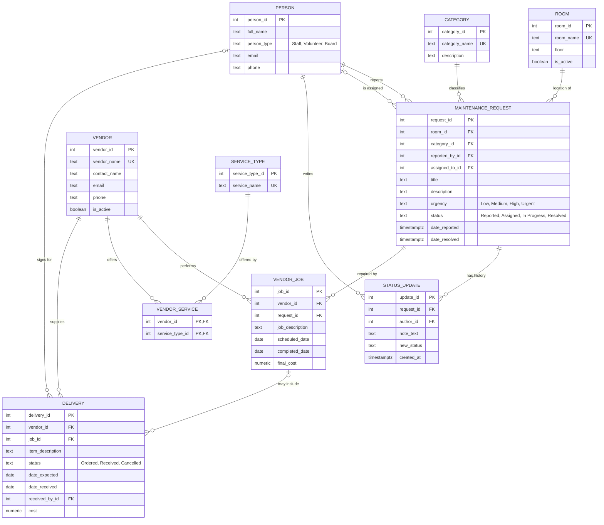

# Wellspring Database Design (Assignment 4)

Team: Annanya Krishnan, Jenifer Back, Ramatoulie Janneh, Elie Bossombo

This document updates the Assignment 3 plan, *From Service Requirements to Database Structure*, for building the database. The service requirements, entities, attributes and business rules stay the same. What changed is how they are built, following the instructor's feedback.

## What changed from the plan

| Plan (Assignment 3) | Built (Assignment 4) | Why |
|---|---|---|
| Two databases: Maintenance, and Vendors & Deliveries | **One PostgreSQL database** with separate tables | Instructor feedback: one database simplifies foreign keys and testing. Access can be limited later with roles or policies. |
| `VendorJob.request_id` and `Delivery.received_by_id` were FK\* links checked by the program | **Real foreign keys** | With one database, PostgreSQL can enforce them (Rules 7 and 8). |
| Rules 2 (staff only), 3, 4 and 9 were enforced by "the program" | **Database triggers** in `wellspring.sql` | The rules hold for every program and every SQL Editor user, and the tests can check them. |
| The ER diagram calls the history table "Note"; the data dictionary calls it StatusUpdate | **`status_update`** | Matches the data dictionary, which includes `new_status`. |
| StatusUpdate "cannot be edited" | **Append-only** (a trigger blocks UPDATE and DELETE) | Keeps a permanent history, like an order-tracking page. |

## Essential tables

All ten tables in the plan are needed to show the complete workflow: report, then assign, then vendor job, then delivery, then resolve.

| Table | Purpose | Key relationships |
|---|---|---|
| `person` | Staff, volunteers, board members | Reports, handles, writes updates, and signs for deliveries |
| `room` | Rooms and spaces | One room has many requests |
| `category` | Kind of problem (HVAC, A/V, ...) | One category has many requests |
| `maintenance_request` | One problem from report to resolution | Belongs to a room, a category and a reporter; may have an assignee |
| `status_update` | Dated history entries | **One request has many status updates** |
| `vendor` | Outside companies | One vendor has many jobs and deliveries |
| `service_type` | Kinds of service (HVAC, Plumbing, ...) | |
| `vendor_service` | Links vendors to services | **Many-to-many**: vendors ↔ service types |
| `vendor_job` | Work a vendor does for one request | **Each job connects to the correct request** |
| `delivery` | Parts or supplies from a vendor | Optionally belongs to a job; signed for by a person |

## Entity-relationship diagram

## Business rules: where each is enforced now

| # | Rule | Enforced by |
|---|---|---|
| 1 | Request needs room, category, reporter, title and description; a note needs a request and an author | NOT NULL, foreign keys, non-blank checks |
| 2 | Cannot move past Reported without an assignee, and the assignee must be Staff | Check `request_assigned_before_progress` + trigger `check_maintenance_request` |
| 3 | Status only moves forward | Trigger `check_maintenance_request` |
| 4 | Cannot resolve while a vendor job has no completed date | Trigger `check_maintenance_request` |
| 5 | `date_resolved` only when Resolved and not before `date_reported` | Checks `request_resolved_*` (the trigger fills in the date automatically) |
| 6 | Room, category, vendor and service names are unique | UNIQUE constraints |
| 7 | Every job has an active vendor and a real request | Foreign keys + trigger `check_vendor_job` |
| 8 | Received delivery needs a date and a signer | Check `delivery_received_details` + foreign key to `person` |
| 9 | Vendors are deactivated, never deleted; only active vendors get jobs | `is_active` + triggers `vendor_never_deleted`, `check_vendor_job` |
| 10 | No negative costs; a job cannot be completed before its scheduled date | Checks on `final_cost`, `cost`, `job_completed_after_scheduled` |
| — | Status history cannot be changed | Trigger `status_update_append_only` |

## Tests (Assignment 4)

`database/workflow-test.sql` runs inside a transaction and rolls back at the end:

- **Part A:** the suggested test. It creates a request for a room, assigns it to a staff member, connects a vendor job, adds a status update documenting the repair, and resolves the request.
- **Part B:** relationship checks. One request has many status updates, one vendor offers many services, one service has many vendors, and jobs and deliveries connect to the correct request.
- **Part C:** each business rule above is broken on purpose, and the database must refuse.

`npm test` runs the same script automatically, along with an end-to-end test of the API.

## SQL practice (Assignment 5)

`database/queries.sql` answers each question:

| Question | SQL used |
|---|---|
| Which maintenance requests remain unresolved? | WHERE, JOIN |
| How many maintenance requests have occurred in each room? | LEFT JOIN, COUNT, GROUP BY (+ HAVING for repeat problems) |
| Which vendors provide HVAC services? | JOIN through `vendor_service`, WHERE |
| What is the total repair cost for each vendor? | SUM, GROUP BY in subqueries, LEFT JOIN |
| Which deliveries arrived after their expected dates? | WHERE comparing two dates |
| How can staff update a request's status and preserve its history? | UPDATE + INSERT in one transaction |
